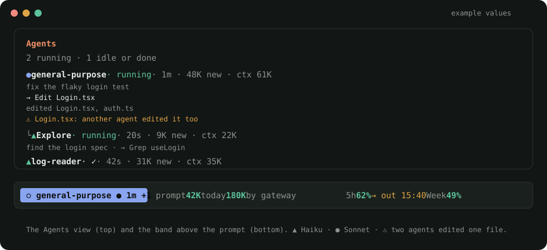

# Subagent Gateway

[](https://github.com/ofri-peretz/subagent-gateway/actions/workflows/check.yml)

**Keep your Claude Code conversation small, see what every agent is doing, and know what it saved.**

Every reply re-reads your whole conversation, so every file dump and log you pull in costs you again on each turn. Subagent Gateway hands that reading to read-only Haiku workers, which read in their own context and return a short report. Your conversation stays on the model you chose. A live view shows every running agent, warns when two of them edit the same file, and the savings are counted from real token usage.



Part of [Interlace](https://interlace.tools): check what coding agents ship.

## Install

At the prompt of a Claude Code terminal session:

```
/plugin install subagent-gateway --marketplace ofri-peretz/subagent-gateway
```

Answer `y` to add the marketplace, then pick a scope. From a shell: `claude plugin install subagent-gateway --marketplace ofri-peretz/subagent-gateway`.

In the Claude desktop app: click + next to the prompt box, then Plugins, Add marketplace with `ofri-peretz/subagent-gateway`, then Add plugin.

Restart open sessions after installing or updating: a plugin loads when a session starts.

## What it does

### Seven read-only workers on Haiku

| Worker | Takes |
| --- | --- |
| `repo-searcher` | Finding files, usages and definitions; reports `path:line` with a short note |
| `log-reader` | Test output, CI and Cypress logs; reports each failing case and its first error line |
| `test-runner` | Running a test command once (Vitest, Jest, Cypress, Newman, `npm test`…); reports totals and failures |
| `docs-reader` | A docs page or a web search; answers one question with its source |
| `diff-reader` | A git diff, branch or pull request, summarized file by file |
| `ticket-reader` | A Jira ticket or Confluence page, through your Atlassian tools |
| `mcp-reader` | Mail, Slack, analytics and other connected (MCP) tools: only what answers the question |

Claude hands them work when the task matches; while the gateway is on, one line beside each prompt tells it to. You can also ask for one by name ("use the log-reader on this CI log").

**Read-only is enforced, not requested.** Every tool call a worker makes is checked before it runs:

- Shell workers may run only read commands (`rg`, `cat`, `git diff`, `git log`, `gh pr view`…), with no `;`, `&&`, redirects or `$(…)`. `test-runner` may also start test commands.
- `ticket-reader` and `mcp-reader` may only call tools whose action searches, lists, gets or reads. Sending, labeling, editing, running queries that write, clicking or navigating is refused.

A refused call is never run, and a worker that tried one is not counted as a hand-off.

### Cheaper models for the built-in agents

`Explore` runs on Haiku and `general-purpose` on Sonnet, both at medium effort. A `general-purpose` task that only looks (find, list, summarize…) and asks for no change runs on Haiku. Forks, teammates and agents that name their own model are left alone.

### The Agents view

Click the ⬡ chip, or run `/gateway agents`. Every agent in the session as a live tree: subagents, the sub-agents they started, and teammates. Each row shows the model, status, run time, new tokens so far, context size, the tool it is running now and the files it edited. `/gateway agents login` shows only the agents whose task, type or files mention "login".

**Collisions.** When two running agents edit the same file, or an agent edits a file the main conversation changed after that agent started, both rows get a ⚠, the band's chip counts them, and one toast names the file and both agents. Agents in separate worktrees edit separate paths, so they never collide.

### Tips, one of each per prompt

| When | Tip |
| --- | --- |
| The main conversation reads 5 files in a row, or one read brings in 8K tokens or more | Names the worker that could have taken it, and counts a missed hand-off |
| Edits with no test, lint, type check or build run since the prompt | Run them before calling it done |
| A `sleep` or a wait loop | Run it in the background and let the notification tell you |
| 3 or more test runs or installs at once | They slow each other: let one finish |
| 6 or more agents running at once | Check each one is needed: they all draw on your usage limit |

### The band and the Savings pane

```
⬡ log-reader ▲ 42s +1   prompt 42K   today 180K by gateway · 1.4M by all subagents      5h 62% → out 15:40   Week 49%   ⟲ Ctx 41%   Savings
```

- **⬡ chip:** the newest running agent, its model, its run time, and how many more run. Click it for the Agents view.
- **prompt / today:** tokens the workers kept out of your conversation, next to what all subagents kept out.
- **5h / Week:** your usage limits; `→ out 15:40` when this pace would use a limit up before it resets.
- **⟲ Ctx:** how full the context is. Click it to compact.

The Savings pane (`/gateway`, or the Savings button) shows today, the last 7 days and all time, a 14-day trend, worker runs, other agent runs and missed hand-offs, each prompt of this session, savings per agent type, and your limits with the forecast.

## How savings are counted

- **Kept out:** the tokens a subagent took into its own context beyond what its first request held (system prompt, tools and its task, which the main conversation holds too), less the report it returned. From each subagent's real token usage. Forks and nested subagents don't count.
- **By gateway** counts the workers only. Other subagents keep their reading out with or without this plugin, so they show under **All subagents**. The gateway's part for them is **Cheaper model**: the new tokens they took in and wrote on Haiku or Sonnet because it routed them. Cache reads are left out, since every request re-reads the agent's own context.
- **Side by side:** how long agents ran in parallel. It is not claimed as time saved: they might never have run one after another.
- **Runs:** an agent continued over several turns is one run.

## Commands and prefixes

- `/gateway`: the Savings pane. `/gateway agents [word]`: the Agents view, filtered by the word. `/gateway off` and `/gateway on`: turn the workers and subagent routing off or on.
- Start a prompt with `o `, `s ` or `h ` to run that one prompt on Opus, Sonnet or Haiku. The next prompt goes back to your model. Past 50K tokens of context you get a warning, because the switch re-reads everything.

## Privacy and cost

- **Nothing leaves your machine.** The plugin makes no network or model calls of its own. Savings history is one row of counts per day, in `~/.claude/plugins/store/subagent-gateway_*.json`. No prompt text, file content or file name is stored there. Delete that file to clear the history.
- **Latency:** its hooks take about 0.3 ms per tool call (measured in the plugin's test harness, which adds overhead of its own). The hand-off line beside each prompt is about 70 tokens.

## FAQ

**Does it change my model?** No. Your conversation stays on the model you chose; only subagents are routed. A prefix (`o `, `s `, `h `) changes one prompt and only when you type it.

**Why not switch the whole conversation to a cheaper model?** The prompt cache belongs to the model that wrote it, so the new model re-reads the whole conversation at full price. A subagent starts small.

**Why is "by gateway" much smaller than "all subagents"?** It counts only what this plugin's workers did. Other subagents would have kept their reading out anyway, so the plugin doesn't take credit for them.

**`/gateway` does nothing.** Type it as a message of its own, not inside a sentence, and restart the session after installing or updating.

**How do I turn it off?** `/gateway off` turns off the workers and routing for the rest of the session; uninstall with `/plugin`.

## Where it works

The Claude Code CLI and the desktop app (Code tab). In the VS Code extension (Cursor too) the workers, routing and counting run; whether the band and panes are drawn there is up to the extension.

## Development

```
claude plugin validate .
claude plugin test .
```

See [CONTRIBUTING.md](CONTRIBUTING.md). Changes are in [CHANGELOG.md](CHANGELOG.md); security reports go by [SECURITY.md](SECURITY.md).

## Credits

By Ofri Peretz, as part of [Interlace](https://interlace.tools). MIT licensed; see [LICENSE](LICENSE).
